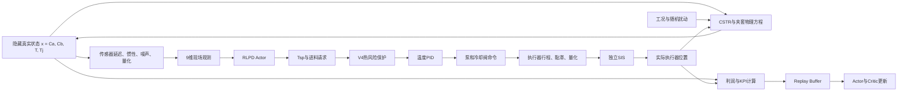
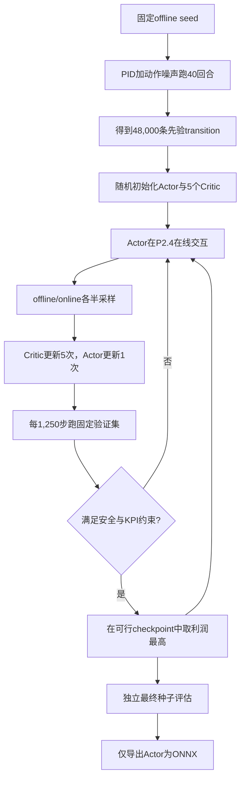

# CSTR-RLPD 项目黑箱拆解与研究重置说明

> 本文只描述当前主线：`P2.4 industrial_p4 + 9维现场观测 + 监督式RLPD + PID + V4 + SIS`。
> 早期5维/8维/13维策略、Risk-Gate、Cost-Critic和reward扫描只作为历史实验，不混入主线解释。

## 如何阅读这份文档

不需要一次读完。建议分三遍：

1. **第一遍，约20分钟**：只读第2、4、5、6、9、10和14节。目标是看懂一次控制步和分数从哪里来。
2. **第二遍，约30分钟**：读第7、8、11和12节。目标是理解物理模型、随机扰动和RLPD训练。
3. **第三遍**：读第15到23节。目标是区分已知与未知，并决定以后什么实验值得做。

阅读时先不要追求记住参数。只要始终能回答三个问题即可：Actor看到了什么、Actor的请求怎样变成实际动作、最终分数在奖励什么。

## 1. 为什么现在需要停下来

过去一段时间的迭代产生了不少有效代码和实验结果，但也逐渐出现三个问题：

1. 环境、reward、动作范围、保护层和checkpoint规则曾同时变化，单次分数变化不容易归因。
2. benchmark从“检验假设的工具”变成了“继续修改的理由”。
3. 代码由多轮快速实现累积而来，版本日志比统一心智模型更完整，使用者很难从头讲清一次episode。

因此当前阶段不应该继续增加reward项、critic、门控或仿真模块。先冻结主线，建立一套能够被人解释、复现和质疑的项目结构。

## 2. 当前项目一句话定义

当前项目研究的是：

> 在一个带夹套、工业仪表误差、执行器动态、冷却水力和随机工况的集总参数CSTR仿真中，不使用在线浓度测量的监督式RL，能否通过选择温度设定值和进料量，在独立安全保护下获得高于固定PID的经济收益。

这句话里有四个边界：

- 它是**集总参数仿真**，不是经过装置数据辨识的数字孪生。
- RL是**上层设定值优化器**，不是直接替代底层PID。
- 浓度是仿真内部隐藏状态，不是策略输入。
- V4和SIS独立于神经网络，RL不是唯一安全责任主体。

## 3. 当前最重要的研究问题

主问题应固定为：

> 在相同P2.4环境、9维观测、动作接口和测试种子下，能否稳定训练出一种策略，使其在满足零跳闸、越88°C回合率不高于5%、KPI不低于95的前提下，提高相对PID的长期平均利润，并能跨训练随机种子复现？

“稳定训练”与“找到一个好checkpoint”不是同一件事。当前前端V1是很好的单checkpoint，但相同流程不能稳定复现它，这是现阶段最关键的算法问题。

## 4. 一张图看懂系统



最需要记住的是：**Actor输出的不是最终阀门动作**。动作还会依次经过V4、PID、执行器动态和SIS。

## 5. 三种“状态”不能混淆

### 5.1 仿真隐藏真实状态

P2.4物理模型内部状态为：

```text
x = [Ca, Cb, T, Tj]
```

| 变量 | 含义 | Actor能否直接看到 |
|---|---|---|
| `Ca` | 反应物A浓度 | 否 |
| `Cb` | 产物B浓度 | 否 |
| `T` | 反应器真实温度 | 否，Actor看到的是测量值 |
| `Tj` | 夹套真实温度 | 否，Actor看到的是测量值 |

浓度虽然不进入策略，但仍参与反应速率、放热、产量和利润计算。删除浓度观测不等于删除浓度状态。

### 5.2 仪表测量状态

真实状态经过传感器模型后才成为控制器可用信号。当前传感器包含：

- 固定延迟；
- 一阶惯性；
- 高斯噪声；
- 温度通道随机漂移；
- 仪表分辨率量化。

实现位于`aiogym/realism.py`中的`SensorChannel`和`IndustrialP2Realism.measure()`。

### 5.3 Actor的9维observation

当前现场策略输入严格为：

```text
[T, Tj, Tsp, Tfeed, Tcoolant_supply,
 Ffeed/Fmax, Fcool/Fjmax, dT/dt, dTj/dt]
```

| 序号 | 信号 | 来源 | 主要作用 |
|---:|---|---|---|
| 1 | `T` | 反应器温度仪表 | 当前热状态 |
| 2 | `Tj` | 夹套温度仪表 | 冷却端热状态 |
| 3 | `Tsp` | 当前温度设定值 | 告诉Actor下层正在追踪什么 |
| 4 | `Tfeed` | 进料温度仪表 | 进料显热扰动 |
| 5 | `Tcoolant_supply` | 冷却水供水温度仪表 | 公用工程能力 |
| 6 | `Ffeed/Fmax` | 进料流量仪表归一化 | 实际进料反馈 |
| 7 | `Fcool/Fjmax` | 冷却流量仪表归一化 | 实际冷却反馈 |
| 8 | `dT/dt` | 测量温度滤波差分 | 反应器温升趋势 |
| 9 | `dTj/dt` | 测量夹套温度滤波差分 | 冷却端变化趋势 |

构造位置为`aiogym/env.py::_field_cstr_observation()`。策略没有读取`Ca`或`Cb`的隐藏通道。

## 6. 一次控制步到底发生什么

当前控制周期为`0.5 s`，600秒episode包含1,200个控制步。每一步按以下顺序执行：

1. Actor读取当前9维观测。
2. Actor输出两个`[0, 1]`归一化动作。
3. 第一个动作映射为温度设定值，当前V4部署范围为`45-85°C`。
4. 第二个动作映射为进料泵请求，范围为`0.30-1.00`。
5. V4根据测量温度和温升率决定是否降低设定值、限制进料、提高冷却。
6. 温度PID根据V4处理后的`Tsp`计算冷却阀命令。
7. 命令经过执行器行程时间、黏滞和量化，得到实际执行器位置。
8. SIS检查真实模型温度；达到跳闸阈值时强制停料并全冷却。
9. 数值积分器推进`Ca、Cb、T、Tj`四个状态。
10. 新真实状态经过传感器模型，形成下一时刻测量和9维观测。
11. 环境计算利润、KPI和安全信息。
12. 训练时保存`(obs, actor_action, reward, next_obs, done)`。

注意第12步保存的是**Actor请求动作**，但`next_obs`和reward来自**经过V4/PID/执行器/SIS后的真实结果**。这就是“训练期V4”的含义。

## 7. 物理模型在算什么

### 7.1 反应体系

当前反应仍是抽象一级反应：

```text
A -> B
```

反应速率使用Arrhenius形式：

```text
r = k0 * exp(-EaR / (T + 273.15)) * Ca
```

它不是乙酸乙酯皂化反应。皂化反应是另一个尚未实现的独立环境问题。

### 7.2 四个状态方程

令`F`为进料流量、`V`为反应器体积、`Fj`为冷却流量、`UA`为有效传热系数：

```text
dCa/dt = F/V * (Caf - Ca) - r
dCb/dt = -F/V * Cb + r

dT/dt = [rho*Cp*F*(Tfeed - T) + Qreaction - UA*(T - Tj)]
         / (rho*Cp*V)

dTj/dt = [rhoj*Cpj*Fj*(Tj_in - Tj) + UA*(T - Tj)]
          / (rhoj*Cpj*Vj)
```

代码位于`aiogym/models.py::CSTRJacketedModel.derivatives()`。

这是“完全混合、单一液相、物性常数、集总夹套”的模型。它没有空间温度分布、局部热点、多相传质、详细副反应、结垢形貌或CFD流场。

### 7.3 P2.4冷却系统

P2.4不是把冷却开度直接乘一个常数。其计算链为：

```text
冷却阀开度
 -> 等百分比固有阀特性
 -> 安装阀特性
 -> 泵曲线与管网曲线交点
 -> 实际冷却流量
 -> 流量相关UA
 -> 污垢热阻修正
 -> 夹套换热
```

同时还计算：

- 泵压头一阶响应；
- 有限冷却水总管库存；
- 供水温度恢复；
- 回水再循环对供水温度的反馈；
- 冷却泵效率和诊断用电功率。

主要代码为：

- `aiogym/models.py::cooling_characteristics()`；
- `aiogym/models.py::cooling_hydraulic_details()`；
- `aiogym/env.py::_update_p2_process()`；
- `aiogym/realism.py::P4_DEFAULTS`。

这些参数目前是工程先验，不是由真实泵曲线、阀门数据或装置历史数据辨识得到的。

## 8. 随机性具体来自哪里

随机扰动不是一个统一的“随机噪声”，而是四类不同不确定性。

### 8.1 每回合工况

每个episode从以下工况中抽样：

- `normal`，概率60%；
- `reactive_feed`，概率20%；
- `fouled`，概率15%；
- `utility_limited`，概率5%。

这些工况改变反应活性、反应热、有效传热、泵压头等参数。

### 8.2 回合内慢事件

每回合会安排1到2个慢变化事件，例如：

- 冷却公用工程压力/温度恶化；
- 进料批次温度、浓度、活性和反应热相关变化；
- 冷却泵逐渐退化。

### 8.3 持续轻微扰动

整个episode周期性加入可恢复的小扰动：

- 进料温度脉冲；
- 冷却水温度脉冲；
- 冷却流量短时下降。

### 8.4 仪表与执行器随机性

传感器噪声使用独立随机流，不改变真实过程扰动。这样改变观测合同不会偷偷改变物理轨迹。

调度和更新代码位于`aiogym/env.py::_schedule_disturbances()`和`_update_p2_process()`。

## 9. 控制器不是一个网络，而是四层结构

### 9.1 Actor：经济决策层

Actor只负责回答：

```text
下一步希望温度目标是多少？
下一步希望进料量是多少？
```

它不直接决定最终冷却阀位置。

### 9.2 PID：基础调节层

PID读取测量温度和温度设定值，输出冷却阀命令。由于冷却开度增大会降温，该回路为反作用控制。

实现位于`aiogym/baselines.py::PIDAgent`。

### 9.3 V4：运行保护层

当前V4参数为：

| 参数 | 数值 | 作用 |
|---|---:|---|
| 温升触发温度 | 85.5°C | 高于此温度且继续升温时介入 |
| 硬触发温度 | 86.5°C | 无论温升率如何都介入 |
| 预测窗口 | 5 s | 用当前正温升率预测未来温度 |
| 保护温度目标 | 82°C | 介入时限制Tsp |
| 保护进料上限 | 0.80 | 介入时限制进料 |
| 紧急停料温度 | 87.5°C | 超过时请求停料 |
| 冷却开度下限 | 0.75 | 介入时至少保持该冷却开度 |

V4使用测量温度，不读取浓度。训练环境实现位于`aiogym/env.py::_apply_supervisory_guard()`，独立评估/前端对应逻辑位于`aiogym/eval_cstr_jacketed_rlpd.py::Supervisor`和`frontend/js/sim/controllers.js`。

### 9.4 SIS：最后独立保护层

当前SIS逻辑：

- 真实模型温度达到`92°C`时锁存跳闸；
- 强制进料为0、冷却为1；
- 温度降到`89°C`后解除锁存。

这是理想化的独立安全层。代码直接使用仿真真实温度，没有模拟独立SIS温度变送器、表决逻辑、继电器延迟、阀门失效概率或安全完整性等级，因此不能视为工业SIS验证。

## 10. Reward、Profit和KPI不是同一个东西

### 10.1 当前训练reward

当前主线使用`reward_mode="economic"`，每一步先计算利润率：

```text
profit = 1575 * product
         - 0.7 * cooling_equivalent_power_kW
         - 14 * max(T - 88, 0) / 10
         - 50 * I(T > 92)

reward = profit * reward_scale
```

其中：

```text
product = F/V * Cb
```

代码位于`aiogym/env.py::_economic_profit()`。

### 10.2 当前经济模型的关键限制

这里最容易被“profit”这个名称误导。当前成本并不是完整工厂利润：

- 冷却成本使用**冷却流量等效功率**，不是P2.4另外计算的真实泵电功率；
- 没有扣除进料泵电耗；
- 没有扣除原料成本；
- 没有计算未反应物回收、分离和产品纯度成本；
- 没有计算设备损耗、污垢清洗、启停和跳闸后的停产损失；
- 产品单价`1575`和成本权重是研究口径，不是经过工厂财务数据标定的经济模型。

因此它更准确的名称是：

> 当前仿真定义下的简化经济目标。

这也解释了为什么Actor经常倾向较高进料：进料能直接增加产品收益，但进料和原料的边际成本没有被完整计入。

### 10.3 控制KPI

KPI定义为0到100的控制质量分：

```text
KPI = 100
      - 2 * 平均温度绝对误差
      - 80 * 平均液位误差
      - 0.5 * 超额能耗
      - 60 * 联锁占时比例
```

但当前CSTR：

- 没有液位控制项；
- `energy_scored=False`，KPI不扣除能耗；
- `T>88°C`不会直接触发KPI安全项；
- 只有`T>92°C`等runaway/interlock状态才进入安全占时。

所以CSTR的KPI主要反映：

```text
温度是否跟踪当前设定值 + 跳闸状态持续了多久
```

它不等于利润，也不等于完整安全指标。PID可以KPI接近100但利润为负；高温RLPD也可能因跟踪高设定值较好而保持较高KPI。

## 11. RLPD神经网络到底是什么

当前并不是复杂的Transformer、RNN或世界模型，而是前馈SAC式RLPD。

### 11.1 Actor

```text
9维观测
 -> Linear(9, 256) + ReLU
 -> Linear(256, 256) + ReLU
 -> 均值头mu(256, 2)
 -> 方差头log_std(256, 2)
 -> tanh
 -> 2维[0,1]动作
```

训练时Actor输出随机动作分布，评估和ONNX部署时使用确定性均值动作。

### 11.2 Critic

每个Critic输入：

```text
9维obs + 2维action = 11维
```

结构为两层256单元前馈网络，并在隐藏层使用LayerNorm。当前共有5个Critic和5个target Critic；目标值随机选取Critic子集并取较小值，以降低过估计。

### 11.3 Replay Buffer

RLPD有两个经验池：

- offline buffer：PID先验轨迹；
- online buffer：当前Actor与环境交互产生的轨迹。

在线更新时每个batch约一半来自offline、一半来自online。`UTD=5`表示每采集一个新环境步，Critic更新5次，Actor更新1次。

核心实现位于`aiogym/rlpd.py`。

## 12. 模型是如何训练出来的

当前标准训练流程：



需要澄清：这不是纯离线RL。PID数据只提供先验，模型仍会在仿真中在线探索和更新。

训练入口为`aiogym/train_rlpd.py`：

- `collect_offline()`：收集PID先验；
- `eval_policy_report()`：计算利润、KPI和风险；
- `checkpoint_rank()`：执行安全约束选模；
- `main()`：组织训练、保存PyTorch和ONNX。

ONNX只包含Actor，不包含Critic、replay buffer、优化器、V4、PID或SIS。浏览器加载ONNX后，仍由JavaScript实现其余控制层。

## 13. 当前版本地图

| 名称 | 输入 | 保护 | 用途 | 当前状态 |
|---|---:|---|---|---|
| PID | 温度测量 | SIS | 传统基准 | 保留 |
| 8维分析仪RLPD | 含Ca/Cb | 无 | 理想信息经济上限 | 仅参考 |
| 旧9维标准RLPD | 无浓度 | 可选V4 | 公平同输入基准 | 保留 |
| 前端V1 + V4 | 无浓度 | V4 + SIS | 当前浏览器默认 | 保持不变 |
| 三种子训练期V4 | 无浓度 | 训练和部署均有V4 | 新研究候选 | 不部署 |
| Cost-Critic | 实验合同 | 分支自带约束 | 独立安全critic研究 | 冻结 |
| Risk-Gate/残差盾 | 多种历史合同 | 多种 | 早期风险实验 | 历史 |

不要再把所有`.onnx`都称为“我们的模型”。每个结果必须同时给出输入合同、环境版本、动作范围、保护层和checkpoint来源。

## 14. 当前最可信的同场证据

测试使用P2.4、每回合600秒、全新种子`202607570-202607669`。三训练种子模型的风险分母为300，单模型参考分母为100。

| 控制器 | Profit | KPI | T>88°C | 跳闸 | 结论 |
|---|---:|---:|---:|---:|---|
| PID | -4.00 | 99.78 | 0/100 | 0/100 | 安全稳定但经济性差 |
| 8维分析仪RLPD，无保护 | 13.20 | 98.49 | 100/100 | 48/100 | 高利润但不满足安全目标 |
| 旧9维标准RLPD，无保护 | 13.91 | 98.99 | 293/300 | 73/300 | 同输入经济上限，跨seed风险大 |
| 旧9维标准RLPD + V4 | 10.85 | 99.15 | 0/300 | 0/300 | 安全但事后保护损失较大 |
| 当前前端V1 + V4 | 11.77 | 97.87 | 0/100 | 0/100 | 当前最佳单checkpoint |
| 新训练期V4 + V4 | 11.31 | 98.49 | 0/300 | 0/300 | 平均优于旧训练法，但未超过V1 |

机器可读结果：`aiogym/runs/cstr_jacketed_p24_guard_aware_comparison_600s_100ep.json`。

## 15. 目前已经知道什么

在当前仿真口径和已测试种子内，可以支持以下结论：

1. 不提供在线浓度观测，9维现场策略仍能获得明显高于固定PID的仿真利润。
2. 无保护经济RLPD会系统性靠近或越过热边界，单看profit不可接受。
3. V4在当前测试中能显著降低越温和跳闸。
4. 把V4放入训练闭环，平均结果优于训练后再改变动作范围并加V4。
5. 当前前端V1仍优于三种子训练期V4均值，但V1的训练可复现性不足。
6. 后期训练经常发生Actor经济性能坍塌，checkpoint选择对结果影响很大。

## 16. 目前不知道什么

当前证据不能回答：

1. P2.4参数是否代表任何具体工业CSTR。
2. 真实装置的反应动力学、放热、UA、泵曲线和传感器误差是否落在随机化范围内。
3. 简化profit与真实工厂现金流之间的误差有多大。
4. 未见过的故障组合、传感器故障、执行器卡死和通信延迟下是否仍安全。
5. 9维瞬时观测是否足以恢复所有重要隐藏状态，还是需要历史窗口或状态估计器。
6. 当前V4阈值是否满足独立HAZOP、LOPA或SIL要求。
7. 从仿真迁移到真实装置后，RL是否仍能超过一个经过重新整定的工业PID/MPC。

因此不能使用“已经适合工业部署”“已经证明RL优于PID”这样的表述。准确说法是：**在当前仿真评价函数和随机工况分布内，某些RL策略的简化经济目标高于当前固定PID基准。**

## 17. 为什么之前容易变成benchmark chasing

一个分数同时受到以下因素影响：

```text
物理环境版本
+ 随机工况分布
+ 观测维度
+ 动作范围
+ reward公式
+ Actor训练seed
+ checkpoint规则
+ V4参数
+ 测试seed
```

如果一次改变其中两个以上，分数提高也无法说明是哪种机制有效。更危险的是，同一测试集被反复查看后再调参，它就不再是真正的测试集，而变成了人工参与的验证集。

以后benchmark只能回答预先写好的问题，不能反过来决定“再试一个参数”。

## 18. 研究重置规则

### 18.1 暂时冻结

在完成理解和审计前，冻结：

- P2.4物理方程和随机工况分布；
- 9维观测合同；
- `45-85°C`与`0.30-1.00`动作范围；
- economic reward；
- V4参数和SIS阈值；
- 当前前端V1模型；
- 正式测试种子，禁止用于调参。

### 18.2 每次只允许一个独立变量

例如研究“降低学习率能否减少Actor坍塌”时：

- 只能改变学习率；
- 环境、reward、网络、数据、V4、验证种子和训练预算全部不变；
- 至少三个训练seed；
- 先写预期机制和失败标准，再运行。

### 18.3 不以单一profit决定成功

候选必须按顺序通过：

1. 输入和动作合同一致；
2. 零跳闸；
3. 越88°C回合率不高于5%；
4. KPI不低于95；
5. 在以上约束内比较profit；
6. 报告跨训练seed均值、标准差和最坏模型，不只报告最好模型。

### 18.4 停止规则

满足任一条件就停止该方向：

- 两轮预注册实验均未改善目标机制；
- 改动需要同时增加reward项和保护规则才能成立；
- 改善只出现在一个训练seed；
- 测试集被用于选择参数；
- 解释成本增长快于性能收益。

## 19. 标准实验卡片

以后每次训练前先填写：

```markdown
# Experiment ID

## Research question
一句话问题。

## Hypothesis
为什么这个改动应该有效。

## Mechanism
它预计改变哪一段状态、动作或学习动态。

## Single independent variable
本次唯一改变的变量。

## Frozen components
环境、观测、动作、reward、V4、SIS、网络、数据和种子中哪些保持不变。

## Training protocol
训练seed、offline seed、验证seed、步数、UTD和checkpoint规则。

## Acceptance criteria
安全、KPI、profit和跨seed稳定性门槛。

## Falsification result
什么结果会否定假设。

## Decision
采用、继续验证、冻结或废弃。
```

没有实验卡片，不开始训练。

## 20. 下一阶段分三步，不直接调模型

### 阶段A：理解闭环

目标是能够不用看代码解释一次episode。完成条件：

- 能区分隐藏状态、测量值和Actor观测；
- 能说明Actor、V4、PID、执行器和SIS的先后顺序；
- 能手算一个简化profit；
- 能解释为什么KPI高不代表利润高或绝对安全；
- 能指出ONNX包含什么、不包含什么。

### 阶段B：审计评价函数

不训练模型，只回答：

- 当前产品价值和冷却成本各占多少；
- 加入进料、原料和分离成本后，最优工作点是否改变；
- 真实泵功率与冷却流量等效成本差异多大；
- KPI是否需要独立加入`T>88°C`持续时间。

这一步比继续调Actor更可能改变研究结论。

### 阶段C：只研究训练稳定性

如果阶段A、B完成，算法侧只选一个问题：

> 在不改变环境、reward、网络容量和V4的情况下，如何减少SAC/RLPD后期Actor坍塌和跨seed方差？

优先候选是学习率、Actor更新频率、熵目标或更严格的固定验证早停。一次只研究一个，不重新堆reward。

## 21. 当前主线代码阅读顺序

按以下顺序阅读，不要从前端或历史实验脚本随机跳入：

1. `aiogym/models.py::CSTRJacketedModel`：先看四个状态和物理方程。
2. `aiogym/realism.py`：看真实状态怎样变成测量值、命令怎样变成实际动作。
3. `aiogym/env.py::_field_cstr_observation()`：确认Actor到底能看到什么。
4. `aiogym/env.py::_supervise()`和`_apply_supervisory_guard()`：看动作怎样经过V4和PID。
5. `aiogym/env.py::step()`：串起完整控制步。
6. `aiogym/env.py::_economic_profit()`：看reward实际优化什么。
7. `aiogym/scoring.py`：理解KPI与profit的区别。
8. `aiogym/rlpd.py`：最后再看Actor、Critic和更新公式。
9. `aiogym/train_rlpd.py`：看数据收集、训练和checkpoint选择。
10. `aiogym/eval_cstr_p24_guard_aware_comparison.py`：看正式结论如何产生。

## 22. 自检问题

如果下面十个问题可以独立回答，项目就不再是完全黑箱：

1. 为什么Actor不看浓度，但reward仍能使用产量？
2. Actor输出的两个数怎样变成实际泵和冷却阀动作？
3. V4、PID和SIS分别解决什么问题？
4. 为什么较低Tsp有时反而增加冷却成本？
5. 为什么PID的KPI接近100但profit为负？
6. 为什么官方RLPD profit高但不能作为推荐策略？
7. 当前profit缺少哪些真实工业成本？
8. offline数据、online数据和test seed为什么必须分开？
9. 为什么一个优秀checkpoint不能证明训练方法可靠？
10. 哪些结论是仿真证据，哪些还需要真实装置数据？

## 23. 当前决策

截至本文版本：

- 停止继续修改reward和仿真复杂度；
- 不替换当前前端V1；
- 不继续Cost-Critic和风险门控结构扩展；
- 先完成闭环理解与经济评价函数审计；
- 下一次算法实验只针对训练稳定性，并使用预注册实验卡片。

这不是暂停研究，而是把研究目标从“再提高一个benchmark数字”改回“得到一套可以解释、证伪和迁移的方法”。
