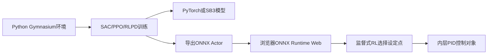

# 上游 GitHub 与当前 P2.4 CSTR 仿真和训练对照

> 整理日期：2026-07-17  
> 上游仓库：<https://github.com/supcon-international/AIO-Gym>  
> 本次代码基线：`origin/main@8dcf7777b9a6a0bbd2e8a58c1579996ed3d1e2d6`  
> 当前版本：以上游基线为底座的本地未提交研究工作区

本文集中回答三个问题：

1. 原始 GitHub 版本的 CSTR 仿真到底怎样运行。
2. 原始 GitHub 版本怎样训练 SAC、PPO 和 RLPD。
3. 当前 P2.4 在物理环境、训练分布、策略和安全机制上改变了什么。

这里的“上游原版”指本地仓库当前记录的官方基线 `8dcf777`。用户最初下载的
`4f9df325` 快照更早，随后上游主要增加了经济价格口径、第五个加热炉场景和
HMI v2；CSTR 的两状态核心方程仍属于下面描述的原始模型。

## 1. 先看结论

| 项目 | 上游原始 CSTR | 当前 P2.4 CSTR |
|---|---|---|
| 环境定位 | 教学和算法演示型强放热 CSTR | 研究级工业现实性压力测试环境 |
| 真实状态 | `[Ca, T]`，2状态 | `[Ca, Cb, T, Tj]`，4状态 |
| 冷却模型 | 开度直接乘等效移热系数 | 阀特性、泵/管网曲线、夹套、UA、污垢、有限水系统 |
| Python 观测 | 5维，不含浓度 | 默认9维现场观测，不含浓度；保留8维 `Ca/Cb` 分析仪上限 |
| 上层动作 | 温度目标和进料目标 | 仍为温度目标和进料目标 |
| 测控现实性 | 浏览器有，Python训练默认没有 | Python和浏览器都实现相应现实性层 |
| 随机工况 | `Uc/k0/Hr`独立宽范围采样 | 相关工况族加连续扰动和设备退化 |
| Python安全层 | 只计算失控标志，默认不联锁 | 92°C独立SIS停料并全开冷却 |
| 经济reward | 产量、冷却成本、88°C软罚、92°C失控罚 | 权重形式基本保留，但产量和冷却量来自新物理模型 |
| RLPD核心 | SAC、5个Critic、50/50离线在线、UTD=5 | 核心算法基本未改，重新在P2.4数据分布上训练 |
| 当前推荐策略 | 原始经济RLPD，无专门外部热保护 | 冻结经济Actor加V4确定性热风险保护 |

最重要的判断是：**当前工作的主要创新在环境和闭环安全结构，不在重新发明
RLPD核心算法。** 同一个算法放入更真实的环境后，原先看起来优秀的策略会暴露
出高温和跳闸风险，这也是必须重新训练和重新评价的原因。

## 2. 上游原始项目的整体结构

原始项目包含多个过程对象，浏览器负责交互演示，Python负责高速训练：



上游浏览器与Python共享物理方程和RK4积分器，并通过golden trajectory测试理想
物理轨迹一致性。但“理想物理一致”不等于“完整闭环一致”，因为原始浏览器有
仪表和执行器现实性层，而原始Python训练环境默认没有完整复刻这一层。

## 3. 上游原始 CSTR 物理机制

### 3.1 状态和反应

原始模型只有两个状态：

```text
Ca：反应物A浓度，mol/L
T ：反应器温度，°C
```

反应是假设的一阶不可逆反应：

```text
r = k0 * exp[-EaR / (T + 273.15)] * Ca
```

参数为：

```text
Dmax  = 0.02       最大稀释率
Caf   = 1.0        进料浓度
k0    = 1e8        指前因子
EaR   = 7000 K     Ea/R
Hr    = 120        等效放热强度
Uc    = 0.05       等效冷却系数
Tcool = 10°C       固定冷却介质温度
```

状态方程为：

```text
D       = feed_opening * Dmax
cooling = cooling_opening

dCa/dt = D * (Caf - Ca) - r
dT/dt  = D * (Tfeed - T) + Hr * r - Uc * cooling * (T - Tcool)
```

这是一个适合展示Arrhenius正反馈和热失控的紧凑模型，但没有显式反应器体积、
夹套热容、冷却水流量和真实换热功率守恒。`Hr`和`Uc`属于等效参数。

### 3.2 原始产量定义

原始产量不是出口产品B流量，而是反应物消耗量：

```text
production = D * (Caf - Ca)
```

因此它隐含假设被消耗的A全部转化为有价值产品，没有显式选择性、副产物和产品
浓度状态。

### 3.3 数值积分

Python和浏览器都使用固定微步长RK4。CSTR微步长为`0.01s`。Python训练通常使用
`control_dt=0.5s`，所以每个控制步内部约做50个RK4微步。

浏览器基础tick为`0.05s`，在常用10倍速时一次tick推进约`0.5s`仿真时间。浏览器
一回合固定为600秒；原始Python训练脚本默认400步，即200秒，除非显式把
`--episode-steps`改成1200。

## 4. 上游原始闭环控制机制

### 4.1 观测

原始Python CSTR基础观测是5维：

```text
[0, T, Tsp, Tfeed, Tamb]
```

第一个`0`是通用level槽位。虽然内部物理状态包含`Ca`，原始RL Actor并看不到
浓度。原始Python可选即时高斯温度噪声，但默认`noise=False`，没有延迟、惯性、
漂移和执行器迟滞。

原始浏览器的浓度会显示在趋势图中，PID也可读取测量状态，但监督式RL的
`obsVector()`仍使用上述5维策略接口。

### 4.2 动作和内层PID

监督式RL输出两个`[0,1]`动作：

```text
action[0] -> Tsp，映射到45~90°C
action[1] -> 进料开度，映射到0.30~1.00
```

RL不直接计算冷却开度。内层反作用温度PID根据`Tsp-T`控制冷却，进料目标则作为
经济操纵变量直接写给进料泵。原始PID温度参数为`Kp=0.08, Ki=0.02, Kd=0`。

### 4.3 上游浏览器现实性层

原始浏览器默认在控制器和物理对象之间加入：

- 温度仪表：0.8秒延迟、1.5秒惯性、0.08°C噪声、漂移、0.05°C量化。
- 浓度分析仪：2.5秒延迟、3秒惯性、0.004噪声、0.001量化。
- 执行器：1.5秒全行程、0.008静摩擦死区、0.004量化和0到1饱和。

浏览器一步的顺序是：

```text
真实状态
-> 传感器故障
-> 仪表现实性
-> 控制器
-> 设备故障
-> 执行器现实性
-> 联锁
-> RK4物理积分
-> KPI和经济评分
```

原始Python训练则基本是：

```text
真实状态 -> 控制器 -> 理想执行器 -> RK4 -> reward
```

这就是原始版本最明显的sim-to-browser分布差异。

## 5. 上游原始随机扰动和故障

### 5.1 Python训练环境

每回合初始状态乘以`±8%`随机因子，进料温度约在名义值`±5°C`内变化。启用
`randomize_plant=True`后，`Uc/k0/Hr`分别在下面范围内独立采样：

```text
Uc: 0.5~1.6倍
k0: 0.55~1.7倍
Hr: 0.85~1.2倍
```

每回合还安排1到3个瞬时事件：进料温度阶跃、环境温度变化、需求变化或设定点
变化。对原始CSTR而言，`Tamb`和`extra_outflow`没有进入CSTR方程，所以环境温度
和需求事件实际上不改变CSTR物理轨迹。真正有效的主要是进料温度和设定点阶跃。

代码虽然有`plant_drift`参数，但上游基线中该参数只被保存，没有实际更新逻辑。

### 5.2 浏览器环境

浏览器每10到32秒清除旧事件并随机选择新事件，约30%概率进入安静期，其余时间
优先选择过程扰动，少量选择硬故障。原始CSTR可能遇到：

- 进料温度阶跃。
- 传感器附加噪声。
- 冷却执行器失效，代码中属于`heater_fault`，因为通用接口把冷却放在heater槽。
- 进料泵跳闸。
- 环境温度和需求事件，但它们对原始CSTR方程基本不起作用。

事件大多是突然出现并持续到下一次自动事件，不是按真实设备退化过程缓慢形成。

## 6. 上游原始安全、reward和KPI

### 6.1 联锁

原始浏览器在真实温度达到`92°C`时锁存进料跳闸，温度降到`89°C`后复位。它会
切断进料，但不会像当前P2.4 SIS那样强制冷却全开。

原始Python环境没有同样的动作联锁。它只把`T>92°C`标记为`runaway`；训练脚本
又设置`terminate_on_runaway=False`，所以策略可以继续跑完整回合。这意味着原始
Python训练与浏览器在高温后的动作轨迹并不完全一致。

### 6.2 经济reward

原始Python CSTR经济目标为：

```text
profit = 1575 * D * (Caf - Ca)
       - 0.7 * (cooling_opening * 80 kW)
       - 14 * max(T - 88, 0) / 10
       - 50 * I(T > 92)

training_reward = 0.03 * profit
```

`88°C`是软经济边界，`92°C`是失控/联锁边界。上游浏览器原始经济评分有88°C
软罚，但没有Python中的显式`-50`失控项，主要依靠停料后产量下降体现代价。

### 6.3 控制KPI

通用KPI为：

```text
KPI = 100
    - 2 * 平均温度绝对误差
    - 80 * 平均液位误差
    - 0.5 * 超额功率
    - 60 * 联锁时间比例
```

原始CSTR没有液位，而且`energy_scored=False`，所以KPI主要衡量温度跟踪和联锁，
不是经济利润。这解释了为什么固定60°C PID的KPI可以很好，但profit不一定高。

## 7. 上游原始训练流程

上游实际提供两条训练路线，不能混为一谈。

### 7.1 `train.py`：Stable-Baselines3 SAC/PPO

这是上游README默认展示的主训练入口：

```bash
python aiogym/train.py --scenario cstr --algo sac --steps 300000
```

流程为：

1. 使用`SubprocVecEnv`创建多个并行Python对象，默认约为CPU核心数减2，最多16个。
2. 默认使用监督式setpoint动作和economic reward。
3. SAC/PPO采用`[256,256]`前馈网络。
4. SAC默认batch为512，每次环境迭代做4次梯度更新。
5. 默认训练300,000步，保存Stable-Baselines3 `.zip`。
6. 训练后用少量回合比较PID、APC-MPC和可用时的NMPC oracle。

这条路线不使用离线先验数据，本质是并行纯在线SB3训练。原脚本也不负责把SB3
模型直接导出为浏览器ONNX。

### 7.2 `train_rlpd.py`：先验数据加在线RLPD

这是当前项目沿用的自写RLPD入口。原始流程为：

1. 先跑16回合PID和MPC基准。
2. 默认收集40回合离线先验。
3. setpoint模式下，先验动作不是实际工厂历史数据，而是“固定PID设定点动作加
   标准差0.15的高斯探索”。内层PID执行这些设定点。
4. 可选执行4000步行为克隆，让Actor接近先验策略。
5. 默认执行5000次离线更新。
6. 在线交互默认30,000步，每个新样本做5次Critic更新。
7. 每2500步做确定性评价，保留最佳checkpoint。
8. 最后以24回合评价并保存`.pt`、`.onnx`和`.json`。

在40回合、每回合1200步的正式配置下，先验池约有48,000条transition。它是
仿真合成先验，不是来自DCS的离线数据。

### 7.3 RLPD网络和更新细节

RLPD核心在上游和当前版本中基本相同：

```text
Actor:  obs -> 256 -> 256 -> mean/log_std -> tanh action
Critic: [obs, action] -> 256 -> 256 -> Q
Critic数量: 5
目标子集: 随机选2个并取较小值
batch: 256
offline/online采样: 各50%
UTD: 5次Critic更新/环境步
gamma: 0.99
tau: 0.005
learning rate: 3e-4
```

Actor训练时是高斯随机策略，部署时导出`tanh(mean)`的确定性动作，并从SAC内部
`[-1,1]`映射到环境`[0,1]`。Critic和Replay Buffer不会导出到浏览器。

## 8. 当前 P2.4 仿真机制

### 8.1 四状态和显式物料/能量衡算

当前模型状态为：

```text
[Ca, Cb, T, Tj]
```

其中`Cb`是产品浓度，`Tj`是夹套温度。当前方程显式使用反应器体积、夹套体积、
流量、密度、热容、反应热和`UA`：

```text
r = k0 * exp[-EaR / (T + 273.15)] * Ca

dCa/dt = F/V * (Caf - Ca) - r
dCb/dt = -F/V * Cb + r

rho*Cp*V*dT/dt = rho*Cp*F*(Tfeed-T)
                  + reaction_heat
                  - UAeff*(T-Tj)

rhoj*Cpj*Vj*dTj/dt = rhoj*Cpj*Fj*(Tjin-Tj)
                      + UAeff*(T-Tj)
```

当前产量改为出口产品流率：

```text
production = F/V * Cb
```

### 8.2 P2.4冷却回路

当前冷却链路包含：

1. 等百分比阀门固有特性。
2. 阀门压降比例形成的安装流量特性。
3. 泵曲线与系统曲线交点。
4. 8秒泵扬程响应惯性。
5. 流量相关换热系数，指数默认0.35。
6. 显式污垢热阻及缓慢增长。
7. 2立方米有限冷却水母管。
8. 45秒供水温度恢复。
9. 8%回水再循环热反馈。
10. 泵效率曲线和物理泵功率诊断。

因此相同冷却开度在泵退化、供水升温或结垢时不再代表相同冷却能力。

### 8.3 P2.4观测和动作

P2.4保留两套明确分开的观测契约。历史分析仪对照使用8维：

```text
[0, T_meas, Tsp, Tfeed_meas, Tamb_meas, Ca_meas, Cb_meas, Tj_meas]
```

当前默认现场策略使用9维，不读取浓度：

```text
[T_meas, Tj_meas, Tsp, Tfeed_meas, Tcoolant_supply_meas,
 Ffeed_meas/Fmax, Fcool_meas/Fjmax, dT_meas/dt, dTj_meas/dt]
```

两者动作仍为两个监督式经济动作，因此算法比较保持相同控制层级。`Ca/Cb`继续作为
仿真隐藏状态参与动力学、产量和reward计算。

### 8.4 P2.4工况和扰动

每回合从相关工况族中选择：正常60%、高反应性原料20%、结垢15%、公用工程受限
5%。这些工况共同决定动力学、反应热、初始污垢和可用泵扬程，而不是把所有极端
参数独立叠加。

回合内还会有：

- 1到2个平滑长事件，包括原料批次、公用工程压力和泵退化。
- 具有时间相关性的进料与公用工程背景波动。
- 每隔一段时间重复出现的轻微进料温度、冷却水温和冷却流量脉冲。
- 原料批次同时联动温度、浓度、动力学活性和反应热。

### 8.5 P2.4测控和SIS

Python训练端现在实现与浏览器相同类型的传感器延迟、惯性、噪声、漂移、量化，
以及执行器行程时间、静摩擦和量化。Actor和PID读取测量值，ODE、reward和SIS使用
真实状态。

P2.4独立SIS在真实温度达到92°C时锁存：

```text
feed = 0
cooling = 1
```

真实温度降到89°C后复位。训练环境和浏览器都执行这套保护。

## 9. 当前 P2.4 训练和部署

### 9.1 标准P2.4 RLPD

标准P2.4对照保留上游RLPD架构和简单economic reward，只是把训练环境换成
`cstr_jacketed + industrial_p4`并重新训练。它不是上游发布的checkpoint。

当前最终续训记录使用：

```text
40个离线先验回合
8维观测，2维动作
5个Critic，UTD=5
从5000步checkpoint继续25000在线步
总训练步标记约30000
无risk observation
无外部安全guard
```

### 9.2 当前推荐无浓度V1 + V4

当前默认策略由两部分组成：

1. 在P2.4重新训练的9维无浓度Actor `rlpd_cstr_jacketed_p24_field_v1.onnx` 负责正常
   工况的温度目标和进料负荷，只读取现场温度、流量与趋势。
2. 确定性V4保护层在测量温度或5秒温升预测接近边界时限制进料、降低温度目标并
   增加冷却。

因此V4的正常经济能力主要来自Actor，安全改善主要来自外部闭环保护。独立SIS仍
作为最后一道保护，不应计作RL自身能力。

### 9.3 当前正式同种子结果

| 控制器 | Profit (¥/h) | 产品 (mmol/s) | KPI | T>88回合 | 跳闸回合 |
|---|---:|---:|---:|---:|---:|
| 固定60°C PID | -4.31 | 8.85 | 99.78 | 0/100 | 0/100 |
| 8维分析仪RLPD，无保护 | 12.93 | 17.42 | 98.39 | 100/100 | 54/100 |
| 9维无浓度RLPD，无保护 | 12.11 | 16.13 | 97.97 | 100/100 | 39/100 |
| 旧V4，分析仪Actor | 11.61 | 17.62 | 98.85 | 0/100 | 0/100 |
| 当前无浓度V1 + V4 | 11.54 | 15.97 | 97.79 | 0/100 | 0/100 |

这说明P2.4重训RLPD仍然找到了高利润边界，但简单经济reward并没有让它主动留出
足够热安全余量。无浓度Actor保留分析仪RLPD约93.6%的利润；叠加V4后相对旧V4
保留约99.4%的利润，并在该100回合样本中保持零越88°C和零SIS跳闸。

## 10. 逐层对比和意义

| 层级 | 上游原版 | 当前P2.4 | 实际意义 |
|---|---|---|---|
| 化学 | 抽象A消耗 | 抽象A到B，增加B状态 | 产量定义更清晰，但仍非具体反应 |
| 反应器 | 无显式V、rho、Cp | 显式反应器热容和体积 | 能量量纲和时间常数更可审计 |
| 夹套 | 固定10°C冷源 | 动态Tj和供回水 | 失冷和热积累不再瞬时 |
| 阀泵 | 开度线性乘冷却项 | 安装阀特性加泵/系统曲线 | 开度不再等于冷却能力 |
| 换热 | 单一Uc | 流量相关UA加污垢热阻 | 换热器故障有物理路径 |
| 测量 | Python近似真值 | 延迟、惯性、噪声和漂移 | 策略必须处理信息滞后 |
| 执行器 | Python即时动作 | 迟滞、限速、死区和量化 | 紧急动作不再瞬时到位 |
| 随机化 | 独立宽范围参数 | 相关工况族 | 减少不合理极值组合 |
| 持续扰动 | 少量阶跃 | OU背景加长事件加轻脉冲 | 整个回合持续考察适应性 |
| Python联锁 | 无动作SIS | 与前端一致的SIS | 高温闭环轨迹更一致 |
| 观测 | 5维，不见Ca | 默认9维现场信号；8维Ca/Cb仅作上限 | 避免部署侧浓度信息泄漏 |
| reward | 简单economic | 权重基本相同 | 环境升级不是靠堆reward实现 |
| RLPD | SAC式RLPD | 同一算法核心 | 性能变化主要来自训练分布 |
| 部署 | 经济Actor加PID | Actor加PID加V4加SIS | 安全责任被分层处理 |

## 11. 哪些变化是真的更好，哪些还没有解决

已经明显改善：

- 反应器与夹套有可检查的物料和能量衡算。
- Python训练端与浏览器端的测控动态和SIS更一致。
- 冷却故障从“直接乘一个效率”变成阀、泵、UA、污垢和公用工程的因果链。
- 随机扰动从独立瞬时阶跃变成相关工况和连续过程。
- 能用相同种子、600秒回合和统一指标比较PID、RLPD和V4。

仍未解决：

- 反应仍是抽象一级A到B，不是乙酸乙酯皂化或具体工业反应。
- 参数来自工程先验，没有DCS历史数据和设备厂家曲线辨识。
- 没有压力、液位、相平衡、副反应、产品质量和完整启停流程。
- profit不是完整工厂P&L，原料、废物、停产和维护成本仍不完整。
- 物理泵功率已经计算，但当前economic reward主要仍按等效冷却流量成本计价。
- 离线先验仍是仿真PID数据，不是真实historian。
- V4是手工保护逻辑和Actor组合，不等于策略已经学会通用安全规律。

所以当前P2.4适合回答“策略在一组更有结构的未知工况下是否稳健”，还不能回答
“它在某座真实工厂是否一定安全和盈利”。

## 12. 复现命令

查看未修改的上游文件：

```bash
git show 8dcf777:aiogym/models.py
git show 8dcf777:aiogym/env.py
git show 8dcf777:aiogym/train.py
git show 8dcf777:aiogym/train_rlpd.py
git show 8dcf777:frontend/js/sim/engine.js
```

运行原始legacy CSTR RLPD：

```bash
python aiogym/train_rlpd.py --scenario cstr \
  --reward-mode economic --action-mode setpoint \
  --episode-steps 1200 --online-steps 30000
```

运行当前P2.4 RLPD：

```bash
python aiogym/train_rlpd.py --scenario cstr_jacketed \
  --realism-profile industrial_p4 \
  --reward-mode economic --action-mode setpoint \
  --episode-steps 1200 --offline-episodes 40 \
  --online-steps 30000 --utd 5 --n-critics 5 \
  --out aiogym/runs/my_p24_rlpd
```

同种子正式评价：

```bash
python aiogym/eval_cstr_p2.py \
  --realism-profile industrial_p4 \
  --safety-profile official_profit \
  --episodes 100 --episode-steps 1200 \
  --seed 20260716 \
  --official-model frontend/models/rlpd_cstr_jacketed_p24_official.onnx
```

## 13. 代码入口

| 内容 | 当前文件 |
|---|---|
| 原始legacy和当前P1物理模型 | `aiogym/models.py` |
| 当前P2.4环境调度 | `aiogym/env.py` |
| 仪表、执行器和P2.4参数 | `aiogym/realism.py` |
| RLPD算法核心 | `aiogym/rlpd.py` |
| RLPD训练入口 | `aiogym/train_rlpd.py` |
| SB3 SAC/PPO训练入口 | `aiogym/train.py` |
| 前端物理模型 | `frontend/js/sim/models.js` |
| 前端P2.4过程状态 | `frontend/js/sim/p2.js` |
| 前端控制器和V4 | `frontend/js/sim/controllers.js` |
| 前端总调度 | `frontend/js/sim/engine.js` |
| 环境演进日志 | `docs/cstr_simulation_environment_change_log.md` |
| 模型和策略日志 | `docs/cstr_model_change_log.md` |
